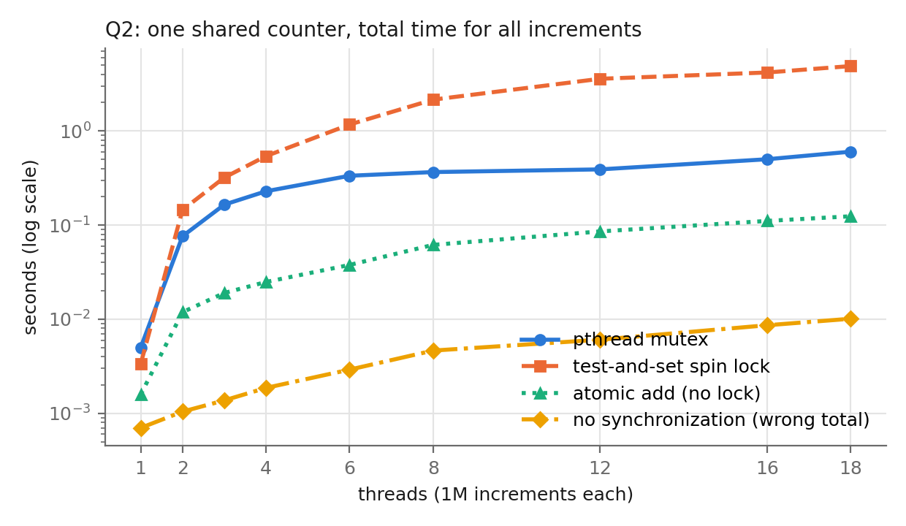
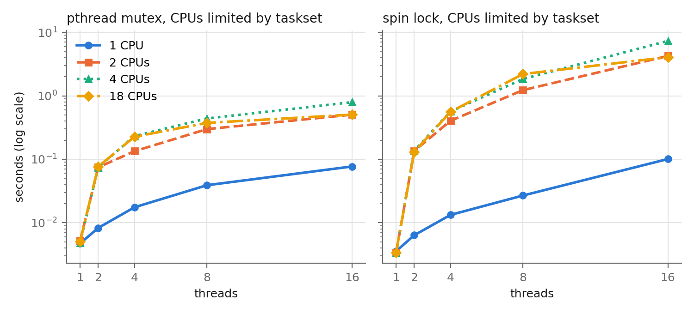
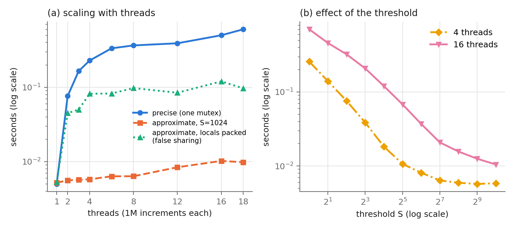
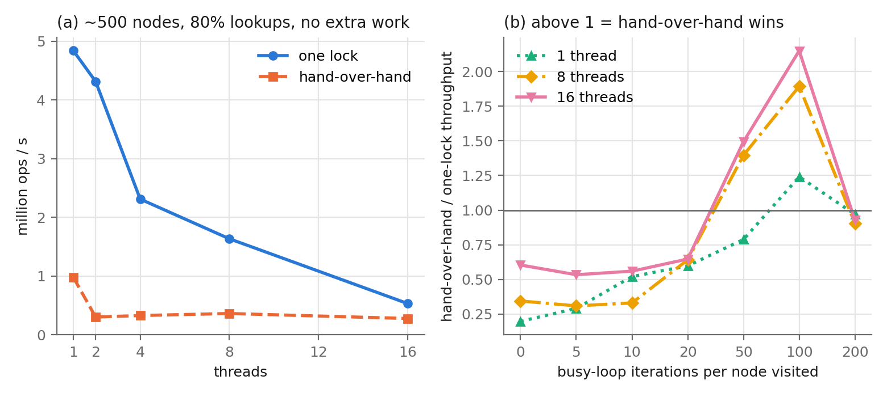
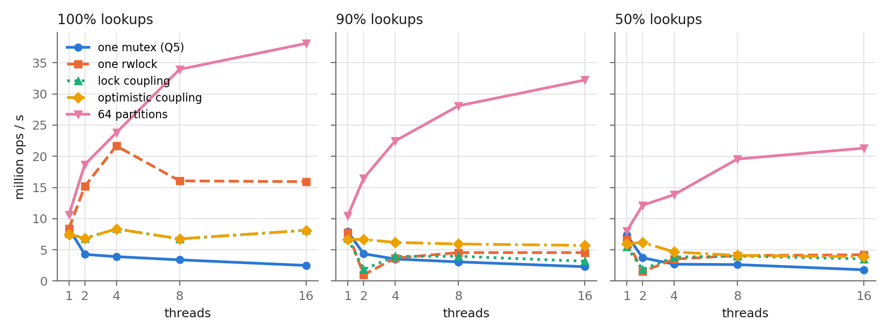

# Chapter 29 — Lock-based Concurrent Data Structures

The chapter has no simulator, so every answer here comes from C code I wrote
and measured. The programs are in this directory, and every number below is
the **median of 5 runs** from `data/*.csv`.

**Machine:** the course VM: Linux 7.0.5 (aarch64) in OrbStack, 18 vCPUs,
16 GB, gcc 15.2 `-O2` (`data/machine.txt`). The host chip is an Apple M5 Max
with 6 performance and 12 efficiency cores, and the vCPUs are not tied to
either kind. A single thread runs 1.0x to 1.4x faster depending on which core
it lands on (I measured `list -w 100` pinned to each vCPU), which is the main
source of noise.

**Files**

| file | question | what it does |
|---|---|---|
| `common.h` | all | timing, start barrier, per-thread random numbers |
| `timer.c` | Q1 | resolution and cost of three timers |
| `counter.c` | Q2 | one shared counter: mutex / spin lock / atomic / none |
| `approx.c` | Q3 | the approximate (sloppy) counter, padded or packed |
| `list.c` | Q4 | sorted list: one lock vs hand-over-hand |
| `btree.c` | Q5, Q6 | B-tree with 5 locking strategies |
| `collect.sh` | all | runs every experiment, writes `data/*.csv` (about 8 min) |
| `plot.py` | all | draws `data/*.png` |

```sh
make                 # builds all five programs
./collect.sh         # TRIALS=5 by default
python3 plot.py
```

Every program starts its threads together at a `pthread_barrier`, and the
clock runs from the moment they are released until the last one is joined.
That way thread creation is not part of the measured time.

---

## 1. How accurate is the timer? (`timer.c`, `data/timer.txt`)

```
counter: cntvct_el0, frequency 24000000 Hz (tick = 41.7 ns)
gettimeofday()             smallest step   1000.0 ns   unchanged  98.1%   cost/call  18.9 ns
clock_gettime(MONOTONIC)   smallest step     41.0 ns   unchanged  70.1%   cost/call  12.5 ns
cycle counter              smallest step     41.6 ns   unchanged  73.4%   cost/call  11.1 ns
usleep(10000) measured as: gettimeofday 14.670 ms, monotonic 14.670 ms, counter 14.670 ms
```

- `gettimeofday()` has a resolution of **1 µs**. It reports microseconds, so
  98% of back-to-back calls see no change at all.
- `clock_gettime(CLOCK_MONOTONIC)` advances in **41 ns** steps.
- This is ARM, so there is no `rdtsc`. The equivalent is the generic
  timer's virtual counter `cntvct_el0`, read with one instruction. It ticks at
  24 MHz, so one tick is 41.7 ns. `CLOCK_MONOTONIC` is built on that same
  counter, which is why both show the same step. Unlike x86's `rdtsc`, the
  counter does not tick at the CPU clock rate.
- One call costs about 11–19 ns. All three are served in user space through
  the vDSO, not by a real system call: a real trap would cost hundreds of ns
  (Chapter 6).
- All three timers agree on a 10 ms sleep. The sleep takes **14.7 ms** because
  the scheduler wakes the thread late, not because the timer is wrong.

The smallest interval I can measure is about 41 ns (1 µs with
`gettimeofday`). One lock operation costs only a few ns, so I never time
single operations. Every run below does about 10^5 to 10^7 operations and
lasts milliseconds to seconds, so timer error is far below 0.1%. All the
programs use `CLOCK_MONOTONIC`, which, unlike `gettimeofday`, cannot jump
when the system clock is adjusted.

A bug I hit along the way: my first version converted
`tv_sec * 1e9 + tv_nsec` to a `double`. Near 1.7 x 10^18 a double can only
represent multiples of 256 ns, so the "resolution" came out as 768 ns. The
fix was to keep the time in 64-bit integers.

---

## 2. A simple concurrent counter (`counter.c`, `data/counter.png`)

This is the counter from Figure 29.2. Each increment is
`lock; value++; unlock`, and each thread does **1,000,000** increments. I
measured four variants:

- `mutex`: the chapter's version.
- `spin`: the test-and-set spin lock from Chapter 28.
- `atomic`: a single hardware atomic add, with no lock.
- `none`: no synchronization at all. This is wrong on purpose (the Chapter 26
  race).



| threads | mutex | spin lock | atomic | none (final value) |
|---|---|---|---|---|
| 1 | 0.005 s | 0.003 s | 0.0016 s | 0.0007 s (1,000,000, correct) |
| 2 | 0.076 s | 0.145 s | 0.012 s | 0.0010 s (~1,006,000 of 2M) |
| 4 | 0.229 s | 0.541 s | 0.025 s | 0.0019 s |
| 8 | 0.366 s | 2.15 s | 0.062 s | 0.0046 s |
| 16 | 0.501 s | 4.18 s | 0.111 s | 0.0086 s (3.7M of 16M) |
| 18 | 0.603 s | 4.89 s | 0.124 s | 0.0101 s |

- With **one** thread a million locked increments take 5 ms, about 5 ns
  each. An uncontended lock is cheap.
- With **two** threads the same work per thread takes **15x** longer
  (0.076 s), even though the threads run on two CPUs at once. The total
  work only doubled. This is the chapter's result (they saw 0.03 s versus
  more than 5 s): the precise counter does not scale at all, and it gets
  *worse* with every thread added.
- **Why it gets slower and not just flat:** every increment writes the lock
  word and `value`. Those cache lines must move to whichever core runs the
  next increment, and a coherence miss costs about 100 ns instead of 1 ns.
  When the lock is busy, a pthread mutex puts the thread to sleep in the
  kernel (futex) and has to wake it later. That is two system calls and a
  context switch per handoff.
- The **spin lock** is the worst at scale: 4.9 s at 18 threads, 8x slower
  than the mutex. Every waiter keeps running `xchg` on the lock's cache line,
  which takes the line away from the holder (Chapter 28, Q14).
- Even **one atomic instruction** with no lock at all slows down 75x from
  1 to 18 threads. The cache line itself is the bottleneck, not the lock.
- **No synchronization** is fast and wrong: 16 threads produced only
  3.7M of 16M. That is the lost update from Chapter 26.

**How many CPUs, and does it matter?** `nproc` reports **18**. To see whether
the number matters, I limited the process to 1, 2, 4 or all 18 CPUs with
`taskset` (`data/counter-cpus.csv`):



| threads | mutex, 1 CPU | mutex, 2 CPUs | mutex, 18 CPUs | spin, 1 CPU | spin, 4 CPUs | spin, 18 CPUs |
|---|---|---|---|---|---|---|
| 2 | 0.008 s | 0.075 s | 0.077 s | 0.006 s | 0.136 s | 0.131 s |
| 16 | **0.077 s** | 0.505 s | 0.506 s | **0.101 s** | **7.34 s** | 4.07 s |

It matters a great deal, and in a surprising direction:

- On **one CPU** the counter is **fastest**: 16 threads take 0.077 s, which
  is 16 x the single-thread time. Only one thread runs at a time, so the
  cache lines never move between cores. A thread is very rarely preempted in
  the middle of its 5 ns critical section, so it almost always finds the lock
  free. The threads simply run one after another, each for a time slice.
- As soon as there are **two or more CPUs**, threads really do run at the
  same time, and the cost of contention appears.
- The **spin lock on 4 CPUs with 16 threads** is the worst result of all
  (7.3 s, versus 4.1 s on 18 CPUs). With more threads than CPUs, the lock
  holder can be preempted while the other threads on the CPUs spin for whole
  time slices. That is the waste measured in Chapter 28 (Q6, Q13), now on
  real hardware.

So "more CPUs" does not make a single-lock counter faster. It only adds
contention, and the number of CPUs determines how much contention there is.

---

## 3. The approximate counter (`approx.c`, `data/approx.png`)

This follows Figure 29.4. Each thread has its own local counter with its own
lock. When the local count reaches the threshold **S**, the thread takes the
global lock, adds the local count to the global one, and resets the local
count to 0. The chapter keeps one local counter per CPU. I keep one per
thread, which is the same thing when there are no more threads than CPUs, and
it means the local lock is never contended. Each local counter sits on its
own 128-byte block. The `-u` flag packs them next to each other instead
(see the false-sharing result below).



**(a) Threads, S = 1024, 1M increments per thread**

| threads | precise (mutex) | approximate | approximate, packed |
|---|---|---|---|
| 1 | 0.0050 s | 0.0052 s | 0.0053 s |
| 2 | 0.076 s | 0.0056 s | 0.045 s |
| 4 | 0.229 s | **0.0058 s** | 0.082 s |
| 8 | 0.366 s | 0.0064 s | 0.098 s |
| 16 | 0.501 s | 0.0102 s | 0.120 s |
| 18 | 0.603 s | 0.0098 s | 0.097 s |

The approximate counter scales almost perfectly. Four threads doing 4M
increments take 5.8 ms, about the same as one thread doing 1M (5.2 ms). At
16 threads it is **50x faster** than the precise counter. This matches the
chapter, which says the time on four processors is "hardly higher" than on
one. The slight rise past 8 threads comes from the slower efficiency cores
and from the global lock, which is taken once every 1024 increments.

**False sharing.** When the local counters are packed next to each other
(56 bytes each, so most 64-byte lines hold parts of two), the approximate
counter loses most of its benefit: 0.12 s instead of 0.01 s at 16 threads.
The threads never touch the same *variable*, but they do write the same
*cache line*, and the coherence protocol moves whole lines. The chapter's
`counter_t` declares `local[NUMCPUS]` as a plain array, which has exactly
this problem. Padding each local counter to its own line fixes it.

**(b) Threshold, 1M increments per thread**

| S | 4 threads | 16 threads |
|---|---|---|
| 1 | 0.258 s | 0.704 s |
| 4 | 0.076 s | 0.323 s |
| 16 | 0.018 s | 0.120 s |
| 64 | 0.0081 s | 0.037 s |
| 256 | 0.0059 s | 0.016 s |
| 1024 | 0.0058 s | 0.0105 s |

- **S = 1** takes the global lock on every increment. It is the precise
  counter with an extra lock, and it is even slower (0.258 s against 0.229 s
  for 4 threads).
- Each doubling of S roughly halves the time until the global lock stops
  mattering. That happens around S = 128 with 4 threads and around S = 1024
  with 16 threads: more threads need a larger S. This matches the shape of
  Figure 29.6.
- **The cost of a large S is accuracy.** `get()` reads only the global count,
  so it can be off by up to `threads x (S - 1)`. At 16 threads and S = 1024
  the final reading was 15,990,784 of 16,000,000. The missing 9,216 are still
  in local counters. That is the trade-off the chapter describes: precision
  versus performance.

---

## 4. Hand-over-hand linked list (`list.c`, `data/list.png`)

Both versions are the same sorted, singly linked list with a sentinel head,
supporting `lookup`, `insert` and `delete`.

- **One lock:** a single mutex around the whole operation, like Figure 29.8
  but with a sorted list.
- **Hand-over-hand:** each node has its own mutex. A thread locks the next
  node before it unlocks the current one, so it never holds more than two
  locks:

```c
pthread_mutex_lock(&prev->lock);
cur = prev->next;
if (cur) pthread_mutex_lock(&cur->lock);
while (cur && cur->key < key) {
    pthread_mutex_unlock(&prev->lock);       // release the one behind
    prev = cur;
    cur = cur->next;
    if (cur) pthread_mutex_lock(&cur->lock); // grab the one ahead
}
```

Locks are always taken in list order, so two threads can never wait on each
other in a cycle and there is no deadlock. Delete is safe without anything
extra: the only way to reach `cur` is to hold `prev` first, so while we hold
`prev` nobody else can be holding or waiting for `cur`, and we can `free`
it. After every run the program checks that the list is still sorted with
no duplicates.

**Workload:** the list is prefilled with 500 keys out of a range of 1000.
Operations are 80% lookups, 10% inserts and 10% deletes on random keys, so
the length stays about 500.



**(a) Plain list, no extra work per node** (million ops/s)

| threads | 1 | 2 | 4 | 8 | 16 |
|---|---|---|---|---|---|
| one lock | **4.84** | 4.32 | 2.31 | 1.64 | 0.53 |
| hand-over-hand | 0.98 | 0.30 | 0.33 | 0.36 | 0.28 |

Hand-over-hand is **5x slower even with one thread**. Visiting a node costs
one compare, and hand-over-hand adds a lock and an unlock on every node: on
average 250 extra lock/unlock pairs per operation. With more threads it gets
worse, because every thread walks from the same head and every lock is a
write to a shared cache line. The threads move down the list one behind the
other and cannot overtake each other, so the list behaves like a pipeline
running at the speed of its slowest stage. This is the chapter's warning: the
extra concurrency does not pay for the cost of all those locks.

**(b) When does hand-over-hand win?** I added `-w N`, a busy loop at every
node visited. It stands in for an expensive comparison, such as `strcmp` on
long keys or following a pointer to a node that is not in cache. Throughput
of hand-over-hand divided by one lock:

| work per node | 0 | 5 | 10 | 20 | 50 | 100 | 200 |
|---|---|---|---|---|---|---|---|
| 8 threads | 0.34 | 0.31 | 0.33 | 0.64 | **1.40** | **1.89** | 0.90 |
| 16 threads | 0.60 | 0.53 | 0.56 | 0.65 | **1.49** | **2.15** | 0.93 |

Hand-over-hand pulls ahead (up to **2.1x**) once the work per node is large
compared with the cost of a lock (50–100 iterations, roughly 50–100 ns per
node). At that point several threads really are walking different parts of
the list at the same time. At 200 the advantage disappears again: the threads
are so slow per node that they mostly queue up behind each other, and the
pipeline effect dominates. Even at its best, hand-over-hand on 8 threads only
gets 0.081 M ops/s against 0.114 for **one thread** with one lock.

**When it is better:** long lists, expensive work per node, and many threads
doing mostly read-only traversals. The ideal case is threads working at
*different* positions, for example a long scan following a short lookup.
For a short list with cheap compares, one lock is better, and so is simply
using a better data structure (a hash table or a tree).

---

## 5. A B-tree with one lock (`btree.c -m mutex`)

My data structure is a **B-tree** (CLRS style, with keys in every node).
The minimum degree is T = 32, so each node holds 31–63 keys and uses binary
search within the node. Inserts split full nodes **on the way down**
(preemptive splitting), so an insert never has to go back up the tree. That
property matters for Q6. There are no deletes, and keys are random in
[0, 2^30).

Each run starts from a tree of **1,000,000 keys** (height 4). Every thread
then does 300,000 operations: either a lookup or an insert of a random key.
After every run the program checks all B-tree invariants: sorted keys,
node fill, all leaves at the same depth, and the key count equal to the
prefill plus every successful insert.

The Q5 strategy is one `pthread_mutex_t` around every operation
(million ops/s):

| lookups | 1 thread | 2 | 4 | 8 | 16 |
|---|---|---|---|---|---|
| 100% | **8.43** | 4.27 | 3.91 | 3.40 | 2.50 |
| 90% | 7.90 | 4.37 | 3.53 | 3.07 | 2.30 |
| 50% | 7.41 | 3.73 | 2.70 | 2.63 | 1.80 |

It is the same story as the precise counter: the tree is fastest with one
thread, and every added thread makes it slower. At 16 threads, total
throughput is **3.4x lower** than one thread. Even pure lookups, which could
all run in parallel, are serialized. I counted **voluntary context switches**
with `getrusage` (printed on stderr): with 16 threads the mutex version made
**about 1,000,000** of them in 2 seconds. Nearly every operation found the
lock held, went to sleep in the kernel, and had to be woken up again.

---

## 6. Better locking strategies for the B-tree (`btree.c`)

I implemented four alternatives:

1. **`rwlock`**: one `pthread_rwlock_t`. Lookups take it shared and inserts
   take it exclusive. This is the reader-writer lock from Chapter 31.
2. **`couple`**: lock coupling (crabbing) with a reader-writer lock in every
   node, the B-tree version of the hand-over-hand list. Lookups read-lock the
   child, then unlock the parent. Inserts do the same with write locks.
   Because full children are split before the insert descends into them, the
   insert never needs more than parent + child. The root pointer has its own
   lock, so the tree can grow at the top.
3. **`optimistic`**: lock coupling where an insert *read*-locks its way down
   and write-locks only the leaf. Most inserts change only one leaf. If that
   leaf is full, the insert gives up and redoes it pessimistically (the
   `couple` insert). Whether a node is a leaf never changes, so the insert
   can choose a read or write lock before it locks the child.
4. **`partitioned`**: 64 independent B-trees. Each covers one contiguous
   slice of the key space (the top 6 bits of the key) and has its own mutex.
   This is the per-bucket locking of the chapter's hash table (Figure 29.10).
   Because the partitions are split by *range*, the keys are still in order
   across them, so a range scan would still work.

All lock coupling takes locks top-down (root pointer, then parent, then
child). That is one global lock order, so no deadlock is possible
(Chapter 32).



Million ops/s (median of 5):

| lookups | strategy | 1 thr | 2 | 4 | 8 | 16 |
|---|---|---|---|---|---|---|
| 100% | one mutex | 8.4 | 4.3 | 3.9 | 3.4 | 2.5 |
| | one rwlock | 8.4 | 15.2 | **21.7** | 16.1 | 15.9 |
| | lock coupling | 7.6 | 6.8 | 8.4 | 6.7 | 8.1 |
| | optimistic | 7.5 | 6.8 | 8.4 | 6.8 | 8.1 |
| | partitioned | 10.6 | 18.7 | 23.8 | 33.9 | **38.1** |
| 90% | one mutex | 7.9 | 4.4 | 3.5 | 3.1 | 2.3 |
| | one rwlock | 7.8 | **1.0** | 3.7 | 4.6 | 4.6 |
| | lock coupling | 6.8 | 1.9 | 4.0 | 4.0 | 3.2 |
| | optimistic | 6.7 | 6.7 | 6.2 | 5.9 | 5.7 |
| | partitioned | 10.5 | 16.5 | 22.5 | 28.1 | **32.2** |
| 50% | one mutex | 7.4 | 3.7 | 2.7 | 2.6 | 1.8 |
| | one rwlock | 6.7 | 1.5 | 3.5 | 4.1 | 4.2 |
| | lock coupling | 5.5 | 1.9 | 3.8 | 4.0 | 3.5 |
| | optimistic | 6.0 | 6.2 | 4.7 | 4.1 | 3.9 |
| | partitioned | 8.0 | 12.1 | 13.9 | 19.6 | **21.3** |

Voluntary context switches for one run at 90% lookups (`getrusage`):

| threads | mutex | rwlock | couple | optimistic | partitioned |
|---|---|---|---|---|---|
| 2 | 11,223 | **75,875** | 33,321 | 178 | 189 |
| 16 | 1,182,067 | 62,826 | 140,016 | 54,601 | 31,520 |

**How they compare with the single lock:**

- **One rwlock** is the best of the "one tree" designs for read-only work:
  up to 21.7 M ops/s, 2.6x the single-thread speed. It stops improving after
  4 threads. Taking a read lock still *writes* the lock's reader count, so all
  readers bounce the same cache line, the same effect as the shared counter
  in Q2. With **any writes** it collapses: at 2 threads and 90% lookups it
  manages only 1.0 M ops/s, **8x slower than one thread**. The context-switch
  count shows why: 75,875 sleeps in 0.6 s. A writer waits for the readers to
  drain, readers queue up behind the waiting writer, and every handoff goes
  through the kernel.
- **Lock coupling** lets operations in different subtrees run at the same
  time, but every operation still locks the **root** first, and an insert
  *write*-locks it. Every insert therefore briefly excludes everyone, and
  every lookup does 4 read-lock/unlock pairs (one per level) on shared cache
  lines instead of 1. It ends up no better than the single rwlock. This is
  the same lesson as the hand-over-hand list: more locks are not
  automatically more concurrency.
- **Optimistic coupling** fixes the root problem. Inserts only read-lock the
  upper levels, so the root is never write-locked except for the roughly 1 in
  30 inserts that split a leaf. It is the only single-tree design that does
  not fall apart with a few writers: 6.7 M ops/s at 2 threads against 1.0 for
  the rwlock, with 178 context switches against 75,875. It still does not go
  *above* the single-thread speed, because every operation still updates
  reader counts on the shared root and upper-level nodes.
- **Partitioning** is the clear winner. It reaches **32 M ops/s at 16
  threads with 90% lookups: 4x the single-thread speed and 14x the single
  mutex**. With 64 partitions and 16 threads, two threads rarely want the same
  lock, and different partitions have no shared cache lines at all (each
  `btree_t` is aligned to 128 bytes). Even with one thread it is faster
  (10.6 vs 8.4), because each tree is one level shorter. Its limits are that
  an operation spanning two partitions (a range scan crossing a boundary)
  needs two locks, and a skewed key distribution would overload one
  partition.

**Conclusion:** the fancy per-node schemes (lock coupling, even with the
optimistic trick) beat the single mutex but gain little over a single rwlock
on this machine. The cost of a lock on a shared cache line is about as large
as the work being protected. The design that scaled was the simple one that
**removed sharing**. That is also why the approximate counter beat the
precise one: give each thread or key range its own lock and its own cache
lines. As the chapter advises, start with one big lock, then measure before
adding concurrency.

---

## Connections to earlier chapters

- **Limited direct execution and context switches (Ch. 6).** A
  contended pthread mutex or rwlock does not spin forever. It calls into the
  kernel (futex) to sleep and is woken by another system call, so each
  handoff costs a trap plus a context switch. This is the cost behind the
  1,182,067 context switches of the single-mutex B-tree and the 75,875 of the
  rwlock collapse. The timers in Q1 are cheap because the vDSO avoids that
  trap.
- **Scheduling (Ch. 7–8) and spin locks (Ch. 28).** With more threads than
  CPUs, the scheduler can preempt a lock holder, and spinning waiters then
  burn their whole time slice: the spin-lock counter on 4 CPUs took 7.3 s.
  On one CPU there is almost no contention because only one thread runs at
  a time. This is the Chapter 28 simulator result (waste ≈ the rest of the
  quantum), now on real hardware.
- **Multiprocessor scheduling and caches (Ch. 10).** Most results here are
  cache-coherence effects. A lock or counter written by many cores moves
  between their caches on every write, which is why one atomic add got 75x
  slower, why packed approximate counters suffered from *false sharing*, and
  why the rwlock and lock coupling stop scaling. Chapter 10's advice to
  *avoid sharing* (per-CPU queues, cache affinity) is the same idea as
  per-CPU sloppy counters and per-partition locks. I measured with
  `taskset`, the same affinity mechanism discussed there.
- **Chapters 26 and 28.** The `none` counter is the Chapter 26 lost update
  on real hardware: 3.7M of 16M. `spin` is Figure 28.3's test-and-set lock
  built with `__atomic_exchange_n`, the C version of the simulator's `xchg`.
  The mutex combines spinning with sleeping, the two-phase idea from the end
  of Chapter 28.
- **Address spaces (Ch. 13–16).** Every structure is shared simply because
  threads share one heap. The partitioned B-tree and the per-thread local
  counters regain some of the isolation that separate address spaces give
  processes, while keeping one shared view of the data.
- **Memory (Ch. 14, 17).** Each list node and B-tree node carries its own
  lock: 48 bytes for a mutex and 56 for an rwlock (aarch64 glibc). That turns
  a 16-byte list node into a 64-byte one. Fine-grained locking costs memory as well as
  time.
- **Measurement (Ch. 6 homework, Ch. 19).** The same habits as the
  system-call, context-switch and TLB measurements: check the timer first
  (Q1), repeat runs and take the median, and control which CPUs are used.
  The heterogeneous P/E cores in this VM are a new source of noise, like the
  virtualization effects seen in Chapter 19.
